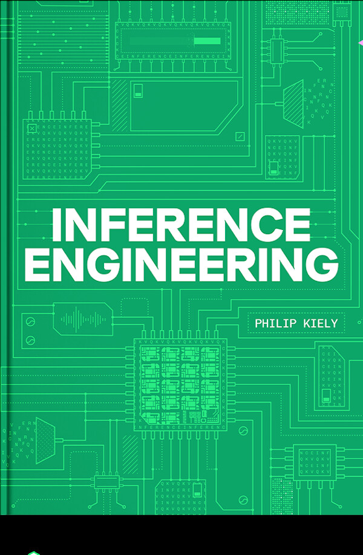

+++
title = "Inference Engineering"
date = 2026-11-21T12:00:00+01:00
draft = false
description = "Le livre de Philip Kiely sur l'inférence en production : GPU, moteurs d'inférence, optimisations et exploitation à l'échelle."
author = 'François Petitit'
+++

**Auteur :** Philip Kiely
**Éditeur :** Baseten Books

Développeur chez Baseten depuis janvier 2022, Philip Kiely rassemble dans ce livre quatre années de documentation, de billets de blog et de conférences sur l'inférence, complétées par des entretiens avec les ingénieurs de Baseten et des échanges avec des clients. L'objectif : servir de guide à celles et ceux qui veulent devenir experts en inférence, c'est-à-dire faire tourner des modèles génératifs en production plus vite, moins cher et de façon plus fiable.

Le livre dresse une carte des technologies et des techniques de l'inférence à travers trois couches : le *runtime*, l'infrastructure et les outils. Le sommaire couvre les prérequis (définition du cas d'usage, budgets de latence et de coût, choix et évaluation des modèles), l'architecture des modèles et les goulots d'étranglement de l'attention, le matériel (GPU NVIDIA, calcul, mémoire et autres accélérateurs), les logiciels (CUDA, PyTorch, Transformers, Diffusers, vLLM, SGLang, TensorRT-LLM et Dynamo), les techniques d'optimisation (quantization, décodage spéculatif, réutilisation du cache KV, parallélisme et disaggregation), les modalités au-delà du texte (voix, vision, *embeddings*, reconnaissance et synthèse vocale) et enfin l'exploitation des services d'inférence en production. Deux annexes proposent un glossaire et des pistes de lecture.

L'ouvrage fait 256 pages, soit environ 46 000 mots. Il est disponible en PDF, EPUB, broché, relié et audiobook (M4B) ; le téléchargement numérique gratuit inclut l'audiobook.

- [Téléchargement numérique gratuit](https://www.baseten.co/inference-engineering/digital-download/)
- [Lire le livre en ligne](https://www.baseten.co/inference-engineering/book/)
- [Acheter un exemplaire papier](https://books.baseten.com/products/inference-engineering)
