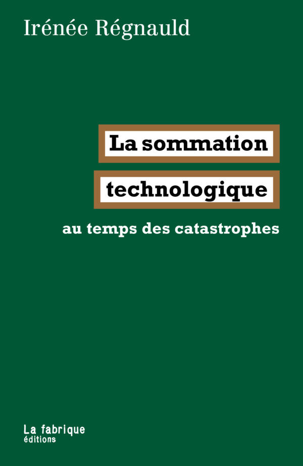

+++
title = "La sommation technologique"
date = 2026-11-21T14:00:00+01:00
draft = false
description = "L'essai d'Irénée Régnauld sur le projet technologique autoritaire qui se structure en France et les pistes d'une critique progressiste."
author = 'François Petitit'
bookAuthor = 'Irénée Régnauld'
+++

**Auteur :** Irénée Régnauld
**Sous-titre :** *au temps des catastrophes*
**Éditeur :** La fabrique éditions
**Sortie :** 11 septembre 2026

Essayiste, sociologue et doctorant à l'EHESS et à l'INSA Rennes, Irénée Régnauld s'intéresse aux implications sociales du numérique. Il montre que, derrière l'agitation des patrons de la tech étasunienne qui occupe l'attention, se structure aussi en France un projet « technofasciste » : des think tanks aux fonds d'investissement, des salons professionnels aux réseaux politiques et entrepreneuriaux, ce projet prend racine dans plusieurs décennies de durcissement sécuritaire, d'extension de la surveillance numérique et de mise sous contrôle des populations désignées comme une menace.

Face à cette sommation technologique et à son déploiement accéléré, l'auteur refuse l'idée qu'il suffirait de détourner le regard ou de « sauter du train ». Il invite à prendre la mesure des bascules en cours, à identifier ceux qui sont aux commandes et à défaire les impasses dans lesquelles une partie de la technocritique s'est laissée enfermer, pour rouvrir la possibilité d'une critique progressiste et d'une maîtrise démocratique des choix technologiques.

L'ouvrage compte 208 pages (ISBN 9782358723282) et est annoncé à 16,00 €. La page de l'éditeur propose un extrait PDF et un lien pour trouver le livre en librairie.

- [Commander sur le site de La fabrique](https://lafabrique.fr/la-sommation-technologique/)
- [Lire un extrait (PDF)](https://lafabrique.fr/wp-content/uploads/2026/05/Regnauld-La-sommation-technologique_BAT-pages-5-7-18.pdf)
- [Trouver le livre en librairie](https://www.placedeslibraires.fr/livre/9782358723282-la-sommation-technologique-au-temps-des-catastrophes-irenee-regnauld/)
