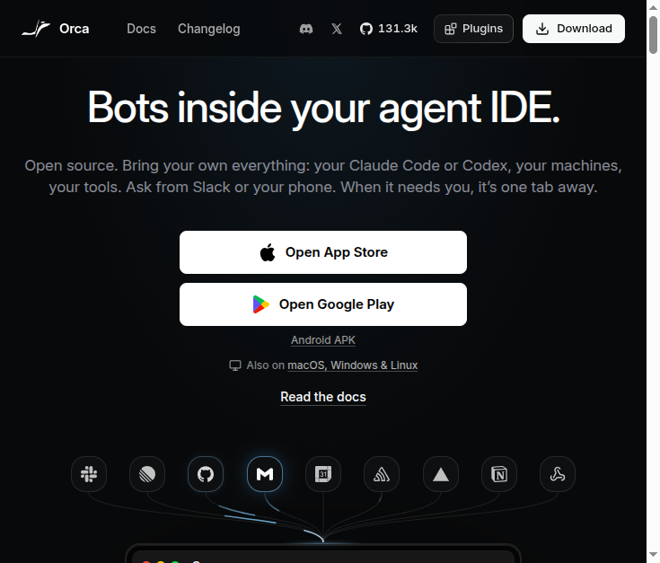
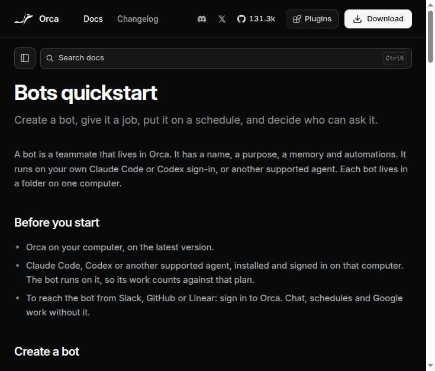
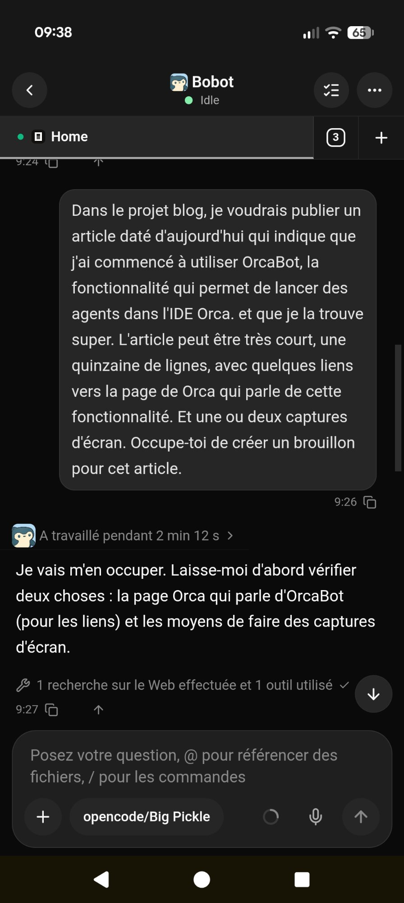

+++
title = "Mon premier bot Orca : un collègue toujours disponible, même depuis mon téléphone"
date = 2026-11-21T09:30:00+01:00
draft = false
description = "Je viens de créer mon premier bot Orca : un robot virtuel toujours disponible auquel je confie des tâches depuis mon téléphone, en toute autonomie."
author = 'François Petitit'
+++

La nouvelle fonctionnalité **Bots** d'Orca vient de sortir, et j'ai tout de suite créé le mien : un petit robot virtuel toujours disponible, et je trouve ça bluffant.

Un bot, c'est un collègue permanent dans Orca : il a un nom, un but, une mémoire et des automatisations. Je lui confie une tâche, il travaille de son côté sur ma machine avec Mistral, OpenCode et Claude, et il me rend la main quand il a besoin d'une décision.

Ce que j'aime le plus, c'est de pouvoir lui donner du travail depuis mon téléphone : je lui envoie une demande en passant, et il avance en toute autonomie sur mon PC de bureau pendant que je suis ailleurs. Je suis prévenu s'il attend quelque chose de moi. La [page de présentation](https://orca.dev/bots) montre le principe, et le [guide de démarrage](https://orca.dev/docs/bots) m'a permis de créer mon bot en quelques minutes. J'ai aussi parcouru [la page sur la sécurité](https://orca.dev/docs/bots/security) pour choisir ce que je lui autorise.

Bref, j'ai longtemps hésité à confier mon bot à des outils en ligne comme OpenAI Dots et Grok Bot, et à tester OpenClaw, que j'avais pourtant installé sur mon poste mais qui me paraissait peu fiable, trop dangereux, trop risqué. Les offres d'OpenAI Dots et de Grok Bot sont très récentes, et je n'avais pas sauté le pas de leur confier mon bot. Là, tout s'exécute sur mon PC, je maîtrise mieux l'écosystème : j'ai peut-être le meilleur des deux mondes, un collègue toujours disponible dans ma poche sans renoncer au contrôle.
